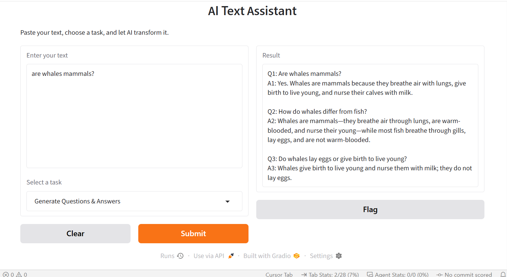

# AI Text Assistant

A beginner-friendly Python app that uses an OpenAI language model to transform text. Paste in some text, choose a task, and get the result in a simple web interface.

**[Live demo](https://ai-text-assistant-vm0f.onrender.com/)**



## Features

Four text transformation tasks:

- **Summarize** text
- **Rewrite** text professionally
- **Extract key points**
- **Generate three questions and answers** from the text

## Example

**Input**

> Artificial intelligence helps computers perform tasks that normally require human intelligence. These tasks include understanding language, recognizing images and making decisions.

**Selected task:** Summarize

**Output**

> Artificial intelligence enables computers to perform human-like tasks such as understanding language, recognizing images and making decisions.

## Tech stack

Python, OpenAI API, Gradio, python-dotenv

## Project structure

```text
Ai-text-assistant/
├── app.py
├── requirements.txt
├── .env.example
├── .gitignore
└── README.md
```

## Run it locally

```bash
git clone https://github.com/Frank-Enebeli/Ai-text-assistant.git
cd Ai-text-assistant
python -m venv .venv
```

Activate the virtual environment:

```powershell
# Windows PowerShell
.venv\Scripts\Activate.ps1

# Windows Command Prompt
.venv\Scripts\activate.bat

# Mac/Linux
source .venv/bin/activate
```

Install the dependencies:

```bash
pip install -r requirements.txt
```

Create a `.env` file in the project root (use `.env.example` as a template):

```text
OPENAI_API_KEY=your_api_key_here
```

Never commit your `.env` file to GitHub.

Start the app:

```bash
python app.py
```

Gradio prints a local address in the terminal. Open it in your browser.

## Model

The app uses the OpenAI model configured in `app.py`. Change it there to try a different one.

## Error handling

The app shows clear messages for common problems:

- Empty input
- Input that is too long (the limit is 5,000 characters)
- Invalid API credentials
- API rate limits
- Connection errors
- Other API errors

## Limitations

- Needs an active internet connection and an OpenAI API key. Usage may cost money depending on your OpenAI account.
- Input is limited to 5,000 characters.
- Responses can sometimes be inaccurate or imperfect, so check important results.
- The app has no conversation history or memory, so each request is independent.
- It does not use RAG or any outside knowledge source. It only works with the text you give it.

## Author

Frank Enebeli
[GitHub](https://github.com/Frank-Enebeli) | [LinkedIn](https://www.linkedin.com/in/frank-enebeli-7aa900b2/) | enebelifrank@gmail.com